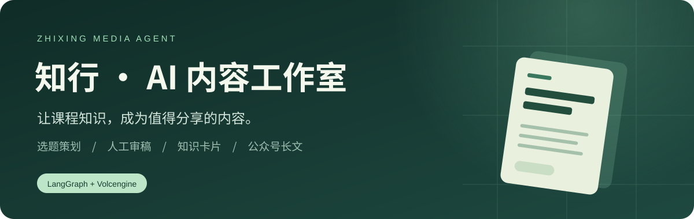
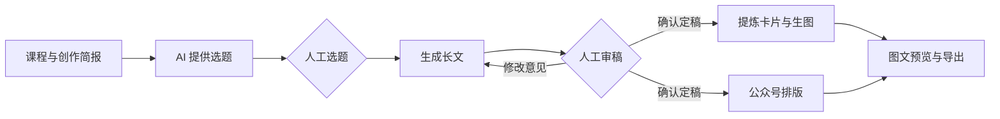

<p align="center"></p>

<p align="center">
  <a href="LICENSE"></a>
  
  
  
  
  
</p>

<h3 align="center">让课程知识，成为值得分享的内容。</h3>
<p align="center">一套面向教育培训与技术创作者的 AI 内容工作台。<br>从选题、审稿到知识卡片与公众号长文，让创作有流程，让定稿有人把关。</p>
<p align="center"><a href="#快速开始">快速开始</a> · <a href="docs/安装与配置.md">安装与配置</a> · <a href="docs/火山方舟接入指南.md">模型接入</a> · <a href="docs/34项实现与验收.md">架构与实现</a> · <a href="CONTRIBUTING.md">参与开发</a></p>
<p align="center"><a href="https://github.com/Y18133948828/zhixing-media-agent">GitHub</a> · <a href="https://gitee.com/yin-zhiyang-0702/zhixing-media-agent">Gitee</a></p>

---

## 从一个选题，走到两种交付

**知行（Zhixing Media Agent）** 把技术内容创作串成一条可审核、可恢复的工作流。它适合 AI 编程培训、课程运营及技术分享：先让 AI 提供选题，再由人决定方向；长文反复审核，确认后生成小红书知识卡片与公众号排版稿。

**公开版默认接入火山方舟真实文字与生图服务。** 源码开源免费，模型调用由使用者自己的火山账号按量付费；需要自行配置 API Key、文字模型 ID 和生图模型 ID。本项目不赠送额度，也不提供收费会员。

| 创作阶段 | 你可以做什么 |
|---|---|
| 选题策划 | 根据课程、受众、素材与已有互动，生成3–5个候选选题，选择或换一组 |
| 人工审稿 | 编辑定稿、附意见重写；需要时加入组长/总监逐级审核 |
| 双渠道交付 | 长文审核后并行生成3–5张小红书图片、公众号 HTML 与 Markdown |
| 内容资产 | 预览、单页重绘、下载图文包；关闭页面后重新登录继续已有任务 |
| 提示词迭代 | 版本管理、稳定 A/B 分流、人工评分、固定评测样本与规则回归 |
| 课程知识 | 素材管理、公开网页导入；可选接入 Embedding 做混合检索 |
| 过程可见 | 持久化 Graph、增量事件、调用耗时与 usage；价格配置后可估算费用 |

> 当前交付到图文文件与 ZIP。小红书、公众号发布由使用者完成，尚未包含平台自动发布、每日调度或实时热点采集。

## 创作流程



LangGraph 使用持久化检查点承载人工断点，PostgreSQL 保存账号、任务、审核版本和内容资产。后台任务不会因为关闭页面而取消；未提交的输入框修改不会自动保存。

## 快速开始

先准备 **Python（推荐3.13）、Node.js 22.12+、已启动的 PostgreSQL（推荐17）**，以及自己方舟账号下的 **API Key + 文字模型 ID + 生图模型 ID**。

下载仓库 ZIP 并解压，或克隆仓库：

```sh
git clone https://github.com/Y18133948828/zhixing-media-agent.git
# 国内可使用 Gitee：https://gitee.com/yin-zhiyang-0702/zhixing-media-agent.git
cd zhixing-media-agent
```

进入根目录后运行：

```sh
# 首次安装：依赖、配置向导、数据库迁移、浏览器与前端构建
python scripts/manage.py setup

# 日常启动
python scripts/manage.py start
```

打开 **[本地工作台](http://127.0.0.1:8000/app/)**，注册账号开始创作。接口调试：[Swagger](http://127.0.0.1:8000/docs)。

安装向导可使用已有数据库账号，也可通过你本地输入的管理员凭据建立专用库和普通账号。应用密钥自动生成，已有 `.env` 不覆盖。**不需要 Docker、Redis、独立 AI 进程或云服务器；不会重复安装 PostgreSQL。**

首次安装需联网下载依赖。macOS/Linux 可以使用 `python3`；当前完整验收环境是 Windows，其他系统的安装步骤与限制见[安装指南](docs/安装与配置.md)。

## 哪些要配，哪些可以以后再说

| 项目 | 首次必需 | 说明 |
|---|:---:|---|
| PostgreSQL 连接 | ✓ | 向导创建/填写，业务数据与 Graph 都持久化 |
| 方舟 API Key | ✓ | 使用者自己的账号与模型权限，保存在后端 `.env` |
| 文字模型 ID | ✓ | 负责选题、长文与卡片提炼 |
| 生图模型 ID | ✓ | 负责真实云图片生成 |
| Embedding / 企业 SSO / LangSmith | — | 可选能力，不影响核心创作流程 |
| 小红书 / 微信开放平台凭据 | — | 当前导出文件供人工发布，不需要平台 API |

完整变量见 [`backend/.env.example`](backend/.env.example)，付费开通、权限与验证见[火山方舟接入指南](docs/火山方舟接入指南.md)。不要把 Key 填到前端或发到公开 Issue。

## 一台电脑，一套服务

```text
浏览器工作台（Vue 3）
        │ HTTP / SSE
FastAPI + LangGraph + 进程内持久任务执行器
        ├── PostgreSQL：业务表 / 任务 / Graph 检查点
        ├── 本地存储：图片 / Markdown / HTML
        └── 火山方舟：文字 / 生图 / 可选 Embedding
```

前端构建后由同一个 FastAPI 进程提供。不同项目可以共用一个 PostgreSQL 实例，分别建立独立库与账号。

```text
backend/app/agents/     Graph、子图、人工审核与状态
backend/app/services/   任务执行、知识检索、图文处理与评测
backend/app/api/        认证、业务接口与 SSE
backend/alembic/        数据库迁移
frontend/src/          Vue 创作工作台
scripts/               安装、启动、检查与发布前扫描
docs/                  接入、设计与使用说明
```

## 真实服务与项目边界

- 默认配置是真实文字与云生图。测试保留隔离的 Mock/HTTP 假服务，真实生成失败不会静默换成样稿。
- 云生图适配器与文字协议有自动化测试，**尚未使用项目维护者的付费凭据完成真实云服务全流程验收**。使用者需按指南验证自己的模型、配额、参数与输出质量。
- 中文密集卡片、代码与事实仍需人工核查；可自行切换本地 HTML 模板渲染，保持排版可控。它是可选图片渲染器，不是独立免费版。
- Embedding、OIDC、LangSmith 为可选适配；向量存 PostgreSQL JSONB 并进行有界混合检索，没有 pgvector/ANN 或集群容量结论。
- 外部调用是至少一次执行，极端情况下重试可能重复产生供应商用量。界面估算费用不替代供应商账单。
- 本地 Demo 默认只监听本机。公开部署、真实课程资料和生产使用需要结合实际场景另行审查。

## 开发与文档

准备独立 `_test` 数据库，设置 `TEST_DATABASE_URL` 后运行：

```sh
python scripts/manage.py check
```

该命令检查 Ruff、依赖、后端测试与前端构建；测试不消耗真实模型额度。开发流程见 [CONTRIBUTING](CONTRIBUTING.md)。

- [安装与配置](docs/安装与配置.md)：首次安装、必需参数、排错与测试库。
- [火山方舟接入](docs/火山方舟接入指南.md)：真实文字、生图与可选向量模型。
- [34项实现与边界](docs/34项实现与验收.md)：工作流、登录、权限与优化设计。
- [接口调试手册](docs/接口调试手册.md) · [OpenAPI 快照](docs/openapi.json)。
- [更新记录](CHANGELOG.md) · [安全说明](SECURITY.md) · [第三方来源](THIRD_PARTY_NOTICES.md)。

## License

原创代码采用 [MIT License](LICENSE)。欢迎学习、修改和参与改进；第三方组件保留各自许可证。模型服务、平台账号与额度由使用者自行准备。
