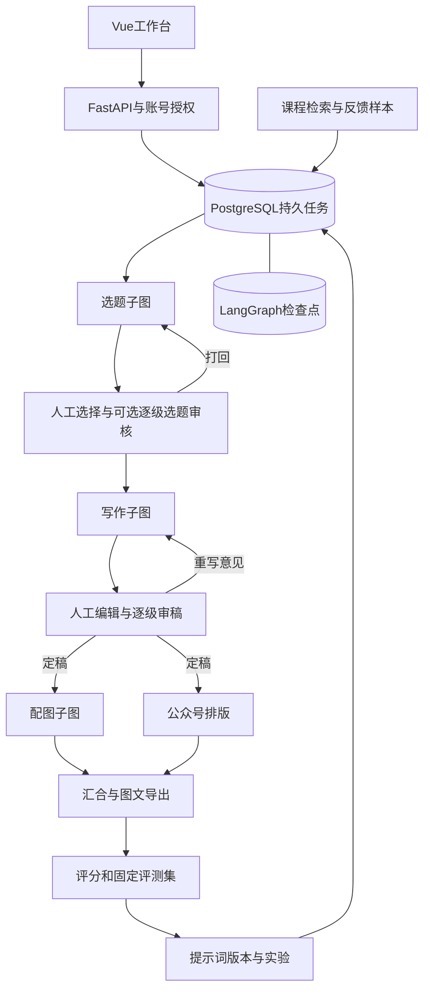

# 飞书34项优化与登录流程：本地实现说明

本轮于2026-10-29通过Ego Lite重新阅读[原飞书文档](https://jianxuanguan.feishu.cn/wiki/Tp4OwJxJgiJKjdkxgYVc9DzMnwc)。原章节名为“难点亮点30条”，实际编号到34，另有项目登录流程。按每项正文核对、实现，没有把副标题当成功能占位符。

本页记录核心实现与范围。2026-11-03开源整理后默认配置改为火山方舟真实文字与生图；原本地验收中的Mock用于隔离测试，不代表真实付费模型已联调。参考来源见仓库第三方声明。

## 逐项对照

“本地实现”表示代码和对应流程已接入；“可选接入”表示需要用户账号/凭据启用，协议测试不等于已完成真实云服务联调。

| 编号 | 原文副标题 | 当前落地方式与边界 |
|---|---|---|
| 1 | Cursor4.5使用技巧 | 属于研发方法说明，非应用功能。保留集中Mock供离线调试，真实模式不执行样稿生成；不把对编程工具的喊话或未经验证的性能说法当项目成果。 |
| 2 | LLM消耗、耗时追踪 | 文本每次尝试记录usage、耗时、成功/失败；云图片按页记录，支持配置单张估价；任务中的向量请求也采集usage。未知用量/价格保留未知，非账单对账系统。 |
| 3 | 在环境变量中引入mock开关 | 文本、图片、检查点分别配置。公开配置默认火山文字与生图、真实PostgreSQL；测试独立使用Mock与模板PNG；内存检查点只允许在`_test`数据库调试，不允许替换正式Demo的持久检查点。 |
| 4 | 使用PostgreSQL数据持久化 | 业务数据、任务队列、事件和Graph检查点持久化。复用使用者已有PostgreSQL实例，配置独立业务/测试库。 |
| 5 | 通过数据持久化，支持Graph时间旅行 | 读取检查点历史、复制为新thread继续；失败恢复从保存的检查点推进。原会话保留，不提供破坏式原地回滚。 |
| 6 | 引入子图SubGraph模式 | 选题、写作、配图分别为子图；父图统一检查点。可指定组长/总监，对选题和长文逐级审核；选题被打回后重新策划，文章被打回后重写。 |
| 7 | 节点并行 | 公众号排版与小红书加工并行并汇合；云生图有界并发、完成顺序不影响页序。模板渲染复用浏览器逐页完成。 |
| 8 | 超时与重试机制 | 每个自动节点超时、HTTP超时、总操作超时；临时错误有限指数退避；失败操作可重试。外部调用不保证恰好一次计费。 |
| 9 | Prompt工程化管理 | 不可覆盖的版本、默认版本切换/回滚、任务完整提示词/参数快照、稳定A/B分流，已有任务不随版本发布改变。 |
| 10 | 流式输出 | 实际消费供应商SSE，增量解析文章，最终Pydantic校验；事件入库并支持按ID续读。Mock增量明确标记，Claude路径仍为非流式。 |
| 11 | 多模型路由策略 | 阶段路由、指定模型覆盖、可选自适应路由；自适应依据输入字符数和本进程观测的延迟/费用，记录实际模型。不能据此宣称节省了某个百分比。 |
| 12 | LLM输出结构化校验 | JSON Schema约束、Pydantic校验、页数/字段/标题去重和代码密度限制；usage单独读取，不因解析成对象而丢失。 |
| 13 | RAG检索增强 | 素材编辑/删除、公开网页导入、分块、Embedding、向量与词项混合检索、来源ID和文章引用校验。向量存PostgreSQL JSONB，Python余弦检索；没有安装pgvector或ANN索引。 |
| 14 | 数据库连接池优化 | 检查点池与业务池独立配置，生命周期释放，连接存活检查。默认小连接池适合本地Demo，没有自动扩容或QPS容量结论。 |
| 15 | 全链路状态追踪Smith | 可选LangSmith根流程/节点追踪，关联task/job/trace；默认关闭。默认只发状态摘要；显式开启内容开关才记录脱敏后的详细State。外部追踪失败不丢弃业务结果。 |
| 16 | 业务指标埋点 | 选题选择率、审稿驳回率、平均修订次数、创作漏斗、人工满意度和按提示词版本分组评分。指标来自本地任务，不是平台全量统计。 |
| 17 | 日志服务 | JSON日志、request_id、task_id/job_id、耗时与状态、文件轮转；不记录密码、认证头和原始请求体。 |
| 18 | 内容安全审查与脱敏 | 常见PII/密钥模式脱敏、可配置禁用词、审查结果记录、可选审查网关。不是完整DLP，也没有冒称已接通火山原生内容安全产品。 |
| 19 | API认证授权、SSO | Argon2密码、JWT签名、资源归属、编辑/组长/总监/管理员角色；可选OIDC授权码+PKCE、nonce、签名/issuer/audience校验、单次回调和浏览器绑定。 |
| 20 | 配置中心抽象 | 系统参数用Settings/环境变量；业务提示词与实验配置入库并提供管理页面。选择原文适合本地的方案，不引入Nacos/Apollo。 |
| 21 | 工作流模板 | 教程/对比/清单内容模板；小红书+公众号、仅小红书、仅公众号交付模板。没有增加原文举例中的掘金/抖音渠道，也没有低代码编排器。 |
| 22 | MCP服务拆分 | 提供LLM、Image、RAG三个可独立启动的标准stdio MCP服务器，复用现有适配器；RAG必须绑定账号命名空间。主Demo不依赖额外MCP进程。 |
| 23 | 健康检查与优雅关闭 | live/ready、数据库和消费者检查、生命周期关闭连接；取消未完成操作后重启可恢复。没有邮件/短信告警或集群自动恢复。 |
| 24 | API版本控制 | `/api/v1`契约、迁移脚本与OpenAPI。没有为凑条目复制一套无差异v2接口；未来破坏性变更可另开版本。 |
| 25 | API限流与熔断 | PostgreSQL原子计数限流，登录单独限流；模型熔断、冷却与单探针半开；图片并发上限。熔断状态是进程内的。 |
| 26 | 用户反馈闭环 | 生成效果评分、维度/意见、版本与结果快照；从定稿保存固定评测样本；A/B版本用同一输入回归；人工评分反哺后续策划上下文。规则分数不等于事实准确率。 |
| 27 | 错误边界与降级策略 | 保存失败与断点、有限重试；配置后可切备用真实模型；缓存命中单独标记。不会把真实生成失败静默替换成Mock，也不对供应商拒绝做跨服务绕行。 |
| 28 | API文档自动化 | 本地Swagger与OpenAPI自动生成，新增接口按功能分组；`docs/openapi.json`保存接口快照。 |
| 29 | `__init__.py`模块管理 | 明确包边界与模型导出；服务按职责拆分，没有通配导入整个项目。 |
| 30 | 图片包含敏感信息，生成失败 | 图片请求脱敏/审查、供应商拒绝显式失败；可编辑后整组或单页重绘。单页只替换指定图片并保留其余资产，不替换成无关内容。图片输出没有额外OCR审查服务。 |
| 31 | 流程性能优化 | 节点并行、SSE、阶段temperature/输出上限、可选轻量路由与限定缓存；不把其他阶段的完整提示词重复塞入每次模型上下文；选题可换一组，提示词要求避免近期重复标题。 |
| 32 | 代码冗余设计优化 | 共用提示词快照、图状态、适配器、检索和格式化模块；重用已有任务执行器承载评测队列。保留必要的校验、权限和恢复逻辑。 |
| 33 | 项目架构设计 | Vue / API / 工作流 / 模型适配 / 存储分层；所有核心服务在同一宿主机Python项目中运行，可选MCP从同代码启动。 |
| 34 | 系统架构设计 | 单个FastAPI进程提供API和构建后的前端，PostgreSQL同时保存业务和Graph；外部模型按需接入，不添加Docker/Redis/集群作为启动依赖。 |

## 登录与多级审核

注册/登录核验数据库中的密码哈希，返回签名JWT；前端请求自动带Bearer，后端按owner_id逐资源校验。JWT不是对个人信息进行保密加密，不在其中存余额、密码或完整用户资料。

退出登录、改密、停用或修改角色会让已有会话失效。权限以服务端账号记录为准，不能靠客户端传入的角色或thread_id前缀授权。本地运行继续查询账号状态，没有Redis依赖，也不声称已经具备无限横向扩展能力。

多级审核默认不打扰单人流程。在创作简报中选择追加审核人，可开启选题逐级审核；只有当前指定审核人能提交。组长/总监可在会话列表看到分配给自己的任务，不能因此修改任务归属、重命名、评分或修改他人素材。选题和文章的审核历史分别保留。

普通注册不会自动获得管理员。需要时，先在工作台注册账号，再在本机运行：

```powershell
cd backend  # 从仓库根目录进入
.\.venv\Scripts\python.exe -m app.manage_user --username 你的用户名 --role admin
```

重新登录后进入“账号设置”，为另行注册的账号分配manager/director角色。此命令只改变指定账号，不会自动提升历史用户权限。

SSO需配置自己的OIDC认证中心、Client ID、可选Client Secret和注册回调。登录页只在配置后显示统一账号入口。SSO账号按issuer+subject绑定，不按相同邮箱自动合并已有本地账号。退出本应用不等于注销认证中心的所有其他应用。实现依据[OpenID Connect Core](https://openid.net/specs/openid-connect-core-1_0-final.html)，真实企业IdP仍待用户配置联调。

## 使用新业务功能

1. “提示词与评测”创建新版本，可选设为默认；复制历史版本可继续修改，启用历史版本相当于回滚发布指向。
2. “A/B分流”对某个阶段设置两个版本和B比例。分组按账号、实验和新任务幂等键稳定计算；已有任务保留原快照。
3. 完成内容后填写满意度和问题，将定稿保存为固定评测样本，可设置必须/禁止出现的词句。
4. “固定样本回归”用一个或两个长文版本运行相同样本。后台队列保存结果，刷新/重启可以继续未完成部分。真实模型模式会产生界面所示次数的模型调用。
5. “创作概览”比较漏斗和评分；小样本与不同读者会造成偏差，不能把相关性当因果提升。
6. “课程素材库”可编辑、删除、导入公开网页、建立索引与试检索。索引失败时不把新正文与旧向量混在一起提交。
7. 图片组支持单页重绘。更换主题或同时修改多页仍使用整组重绘；历史文件保留，当前ZIP仅包含当前资产。

## 配置与真实服务边界

保留现有`backend/.env`，只补需要的字段；不要用示例配置覆盖数据库连接串。完整字段见`.env.example`。

- 文字/生图沿用火山方舟配置：`LLM_PROVIDER=volcengine`、`IMAGE_PROVIDER=volcengine`及ARK相关字段。
- 火山向量：`EMBEDDING_PROVIDER=volcengine`、`ARK_EMBEDDING_MODEL`，共用`ARK_API_KEY`；可选指定模型支持的`ARK_EMBEDDING_DIMENSIONS`。多模态接口的一组输入形成一个向量，因此本项目对各文本块分别请求，避免把多个知识块误合为一个向量。协议参考[方舟多模态向量化API](https://www.volcengine.com/docs/82379/1523520)。尚未用真实Key验收。
- 通用向量：`EMBEDDING_PROVIDER=openai_compatible`，配置Embedding专属地址、Key、模型。更换模型后需要重新索引；默认disabled仍使用关键词检索，不伪装成语义检索。
- LangSmith：配置`TRACING_ENABLED`及追踪凭据。默认关闭；详细内容采集也单独默认关闭。规则脱敏不能保证识别所有敏感信息。
- 内容审查网关：POST配置的`CONTENT_REVIEW_URL`，请求`{text,stage}`、Bearer鉴权，响应`{allowed:boolean}`。网关出错会停止生成。原生火山安全产品签名/响应需由网关适配，当前没有宣称原生接入已验收。
- 备用模型：`LLM_FALLBACK_PROVIDER`、备用地址/Key/模型；默认disabled。缓存默认关闭，显式开启后只缓存相同输入/配置/账号的非选题结果，命中单独标记且不伪造供应商Token。
- 费用：填写自己当前模型单价，显示配置计价单位；没有价格或供应商usage时显示未知。素材建索引等脱离任务上下文的Embedding调用尚未计入任务汇总账单。

向量检索每次最多读2000个分块，适合小素材库；没有ANN索引或容量测试。网页导入仅处理可直接读取的公开HTTPS正文，不登录、不自动跟随跳转，也不是批量爬虫。尚未增加每日定时任务、平台自动采集、自动发布或公众号草稿箱推送。

## 可选MCP

主Demo无需运行这些进程。需要其他本地应用复用时，在各自终端启动相应stdio服务器：

```powershell
cd backend  # 从仓库根目录进入
.\.venv\Scripts\python.exe -m app.mcp_server --service llm
.\.venv\Scripts\python.exe -m app.mcp_server --service image
# RAG独立运行时必须绑定允许访问的账号ID；不能由工具调用者指定其他账号。
$env:MEDIA_MCP_OWNER_ID='工作台账号UUID'
.\.venv\Scripts\python.exe -m app.mcp_server --service rag
```

三条命令分别启动服务，不应在同一终端依次等待它们退出。它们共用本地配置与适配器；真实模型工具调用可能产生费用，stdio仅用于信任的本机客户端，未开放公网MCP端口。

## 结构与验证



新增主要位置：`services/prompt_store.py`、`evaluation_service.py`、`knowledge_service.py`；`core/embedding_client.py`、`resilience.py`、`observability.py`、`content_safety.py`；`api/optimization.py`、`sso.py`；`models/enhancements.py`；四个工作台功能面板与选题审核面板。

数据库通过Alembic新增表和字段；新迁移冻结DDL，不依赖将来ORM模型的变化。历史本地迁移前后核对13张原业务/检查点表摘要一致，版本表按预期升级；没有清库或创建第二套PostgreSQL。该次验收使用Mock文字、模板图片、PostgreSQL检查点；公开版配置默认改为真实方舟文字与生图。

统一检查命令：

```powershell
.\scripts\check.ps1
# 只针对相关用例调试：
.\scripts\test.ps1 -PytestArgs @('tests/test_optimizations.py')
```

自动化覆盖Graph断点/重写、资源归属、OIDC模拟回调、MCP、向量协议、单页重绘和配置保护等。首次开源前本地后端测试通过；云服务真实调用仍需使用者按接入指南验证。历史个人运行日志与浏览器账号不随源码发布，实现、模拟协议验证和真实联调不混称为“全部上线可用”。
